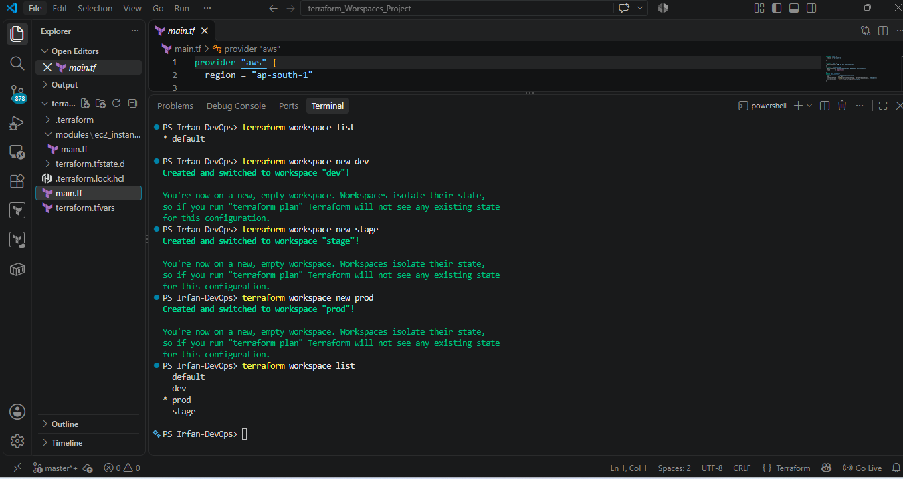
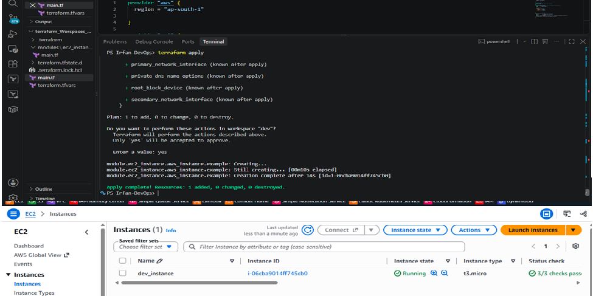
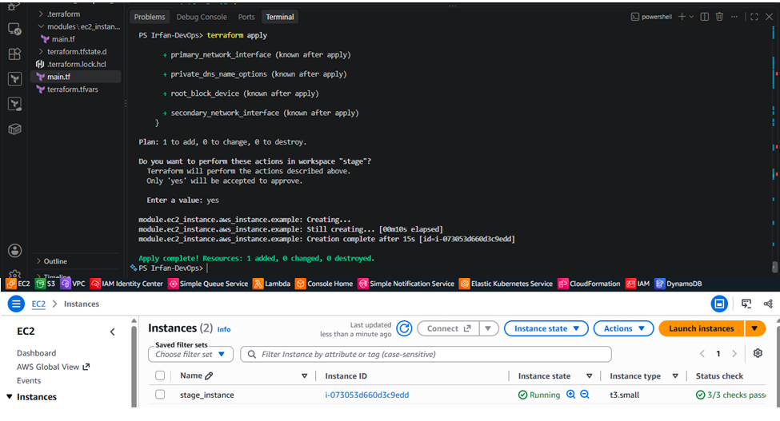
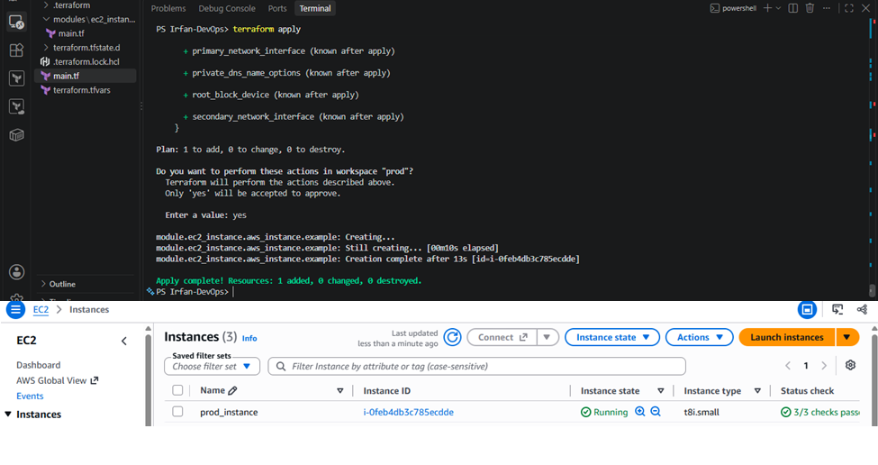
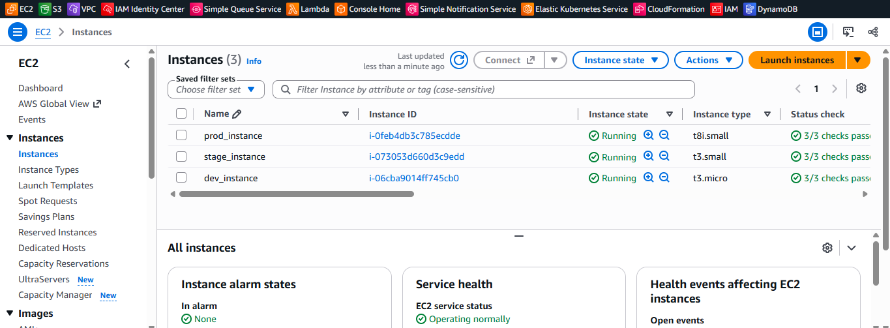
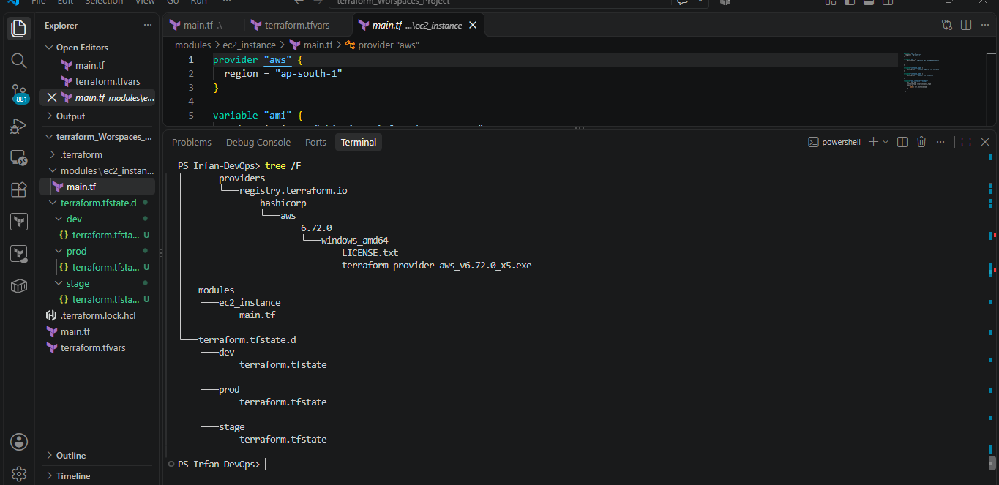

# Terraform Workspaces Project – AWS EC2


## Project Overview

This project demonstrates how to manage multiple AWS environments (Development, Staging, and Production) using Terraform Workspaces and reusable Terraform modules.

I created three separate Terraform workspaces, with one independent AWS EC2 instance provisioned in each environment using a single Terraform configuration.

Each workspace maintains its own Terraform state file, providing separate state management for each environment.

## Technologies Used

- AWS (Amazon Web Services)
- Terraform
- Terraform Workspaces
- Terraform Modules
- Amazon EC2
- HCL (HashiCorp Configuration Language)
- Git and GitHub
- Windows PowerShell

## Project Architecture

- **DEV:** One EC2 instance (`t3.micro`).
- **STAGE:** One EC2 instance (`t3.small`).
- **PROD:** One EC2 instance (`t8i.small`).
- **Reusable Module:** EC2 instance configuration.
- **Terraform Workspaces:** Separate state management for each environment.

## Project Directory Structure

```text
terraform-workspaces-project/
│
├── modules/
│   └── ec2_instance/
│       └── main.tf
│
├── screenshots/
│   ├── workspace-creation-and-list.png
│   ├── dev-ec2-instance.png
│   ├── stage-ec2-instance.png
│   ├── prod-ec2-instance.png
│   ├── aws-ec2-overview.png
│   └── project-directory-structure.png
│
├── main.tf
├── terraform.tfvars.example
├── .gitignore
├── .terraform.lock.hcl
└── README.md
```

## Implementation Steps

### 1. Initialize Terraform

```powershell
terraform init
```

### 2. Create Terraform Workspaces

```powershell
terraform workspace new dev
terraform workspace new stage
terraform workspace new prod
```

### 3. Verify Workspace Creation

```powershell
terraform workspace list
```

**Screenshot – Workspace Creation and List**



[View Full Screenshot](screenshots/workspace-creation-and-list.png)

### 4. Deploy Development Environment

```powershell
terraform workspace select dev
terraform plan
terraform apply
```

**Screenshot – DEV EC2 Instance**



[View Full Screenshot](screenshots/dev-ec2-instance.png)

### 5. Deploy Staging Environment

```powershell
terraform workspace select stage
terraform plan
terraform apply
```

**Screenshot – STAGE EC2 Instance**



[View Full Screenshot](screenshots/stage-ec2-instance.png)

### 6. Deploy Production Environment

```powershell
terraform workspace select prod
terraform plan
terraform apply
```

**Screenshot – PROD EC2 Instance**



[View Full Screenshot](screenshots/prod-ec2-instance.png)

### 7. AWS EC2 Instances Overview

The following screenshot shows the EC2 instances created across the three environments.



[View Full Screenshot](screenshots/aws-ec2-overview.png)

## Terraform State Management

Terraform Workspaces maintain separate state files for each environment.

```text
terraform.tfstate.d/
│
├── dev/
│   └── terraform.tfstate
│
├── stage/
│   └── terraform.tfstate
│
└── prod/
    └── terraform.tfstate
```

Useful Terraform commands:

```powershell
terraform workspace list
terraform workspace show
terraform workspace select dev
terraform state list
```

## Project Directory Structure – Screenshot

The following screenshot shows the actual Terraform project directory and its folders.



[View Full Screenshot](screenshots/project-directory-structure.png)

## Infrastructure Cleanup

After successfully deploying and verifying all three environments, I destroyed the AWS resources to avoid unnecessary cloud costs.

**DEV:**

```powershell
terraform workspace select dev
terraform destroy
```

**STAGE:**

```powershell
terraform workspace select stage
terraform destroy
```

**PROD:**

```powershell
terraform workspace select prod
terraform destroy
```

All three AWS EC2 instances were successfully terminated after project completion.

## Key Learnings

- Managing multiple environments using Terraform Workspaces.
- Creating and reusing Terraform modules.
- Provisioning AWS EC2 instances using Infrastructure as Code.
- Managing separate Terraform state files for different environments.
- Executing Terraform init, plan, apply, and destroy commands.
- Organizing Terraform projects for version control.
- Managing cloud infrastructure and controlling AWS costs.

## Security Best Practices

- Never commit AWS access keys or secret credentials.
- Never upload Terraform state files to GitHub.
- Exclude sensitive `.tfvars` files using `.gitignore`.
- Use `terraform.tfvars.example` to document required variables.
- Keep `.terraform.lock.hcl` in version control.

## Author

**Irfan Ahmad**  
**DevOps Engineer**

- GitHub: [Irfan-devops1](https://github.com/Irfan-devops1)
- **GitHub:** [Terraform Workspaces Project](https://github.com/Irfan-devops1/terraform-workspaces-project)

---

**Project:** Terraform Workspaces – AWS EC2 Infrastructure

**Focus:** AWS | Terraform | Infrastructure as Code | Multi-Environment Management